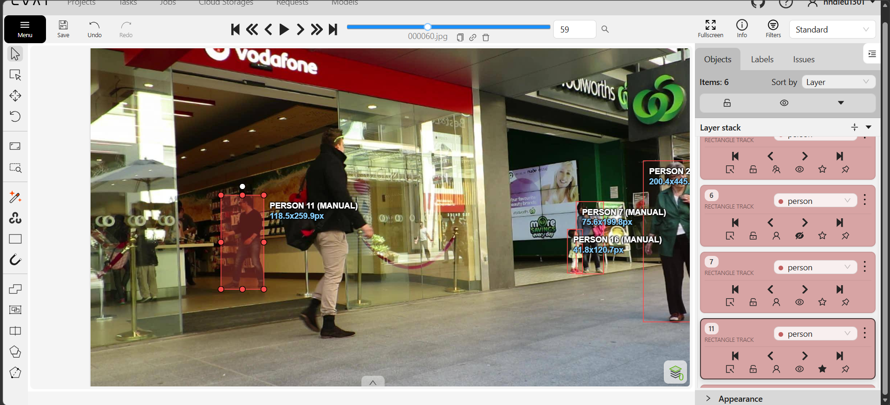
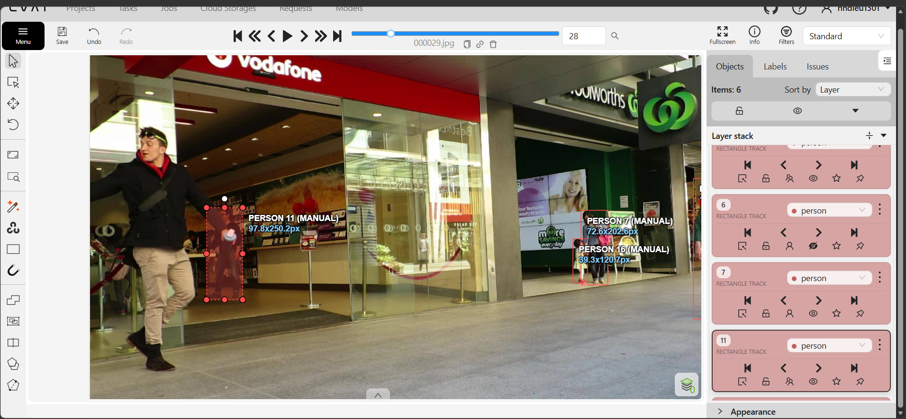
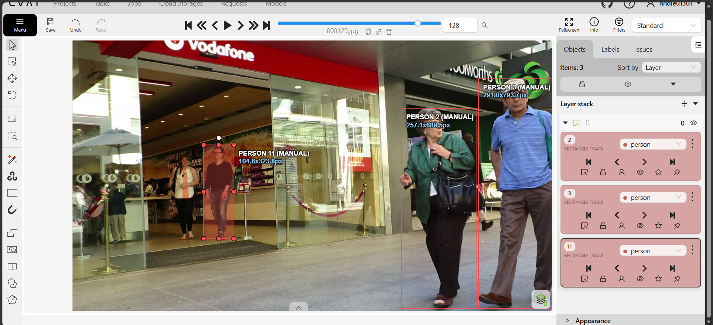

# Báo cáo cá nhân — Nguyen Hoang Dieu - 2A202603174

Đoạn video: MOT17-09, 150 frame (frame 1–150), nguồn MOTChallenge, giấy phép CC BY-NC-SA 3.0.

## 0. Thông tin học viên

- Họ tên: Nguyễn Hoàng Diệu
- MSSV: 2A202603174
- Mã đề (A/B/C): B
- Email: nhdieu1301@gmail.com
- Link repository: https://github.com/nhdieu1301/K5-L2-2A202603174-NguyenHoangDieu-MOTTracking
- Giờ bắt đầu: 16h30
- Giờ kết thúc: 18h

## 1. Xem trước đoạn video (CP0)

| Mã | Frame xuất hiện | Frame cuối thấy được | Rẽ / dừng / đổi tốc độ ở frame | Bị che ở frame | Ghi chú |
|---|---|---|---|---|---|
| **P1** | Người mặc áo tối màu bên trong cửa hàng Vodafone (trái)[cite: 12] | 0[cite: 12] | 149 | Di chuyển chậm bên trong shop, bước ngang qua cửa kính | Frame 30–39 (che một phần), Frame 40–47 (che hoàn toàn bởi người áo khoác đen) |
| **P2** | Phụ nữ đeo kính, áo khoác xanh rêu đậm, quần đen (phải)[cite: 12] | 0[cite: 12] | 149 | Đi thẳng hướng về phía camera, hơi chếch sang trái ở nửa sau | Không bị che |
| **P3** | Nam mặc áo sơ mi xanh dương sáng, quần nâu xám (rìa phải)[cite: 12, 15] | 0[cite: 15] | 149 | Bước từ rìa phải vào (frame 0–40 mới ló cánh tay/nửa người), đi song song bên phải P2 | Frame 0–39 bị mép khung hình phải che một phần[cite: 15] |
| **P4** | Bé gái mặc áo trắng, quần hồng trước cửa hàng Woolworths[cite: 12] | 0[cite: 12] | 146 | Đi bộ cùng P5, đổi hướng nhẹ khi rẽ vào hành lang | Frame 108–110 (che một phần), Frame 111–134 (che hoàn toàn sau P2 và P3)[cite: 17] |
| **P5** | Phụ nữ áo khoác tối màu, đeo túi hồng đi cạnh P4[cite: 12] | 0 | 106 | Đi bộ chậm cạnh bé gái P4, tăng tốc nhẹ ở đoạn giữa | Bị P2 và P3 che khuất hoàn toàn từ sau frame 106 |

## 2. Keyframe và thời gian (CP1, CP4)

| Người | Giờ bắt đầu | Giờ kết thúc | Số keyframe | Số frame thấy | Keyframe / 100 frame | Chỗ khó |
| --- | --- | --- | --- | --- | --- | --- |
| P1 | 17:30 | 17:50 | 31 | 142 | 21.8 | Bị che khuất hoàn toàn đoạn 40–47 và ánh sáng phản chiếu qua cửa kính. |
| P2 | 16:58 | 17:08 | 16 | 150 | 10.7 | Kích thước box thay đổi liên tục khi tiến lại gần camera. |
| P3 | 17:08 | 17:16 | 16 | 150 | 10.7 | Mới ló một phần cánh tay ở rìa phải từ frame 0 nên phải ước lượng box amodal và bật `occluded`[cite: 15]. |
| P4 | 17:16 | 17:24 | 15 | 123 | 12.2 | Bị P2 và P3 đi ngang che khuất hoàn toàn ở đoạn 111–134. |
| P5 | 17:24 | 17:30 | 9 | 107 | 8.4 | Đi khuất sau P2 và P3 ở nửa sau video nên cần xác định đúng frame bật `outside`. |


## 3. Đoạn bị che (CP2)

Người bị che: `P4`

| Mốc | Frame |
|---|---:|
| Bắt đầu bị che một phần (bật `occluded`) | Frame 30 |
| Mất hẳn (bật `outside`) | Frame 40 |
| Hiện lại (tắt `outside`) | Frame 48 |
| Thấy rõ trở lại (tắt `occluded`) | Frame 52 |

- Thời gian khuất hẳn: 8 frame = 0,27 giây.
- Quyết định: giữ cùng ID / tạo track mới.
- Lý do: Giữ nguyên cùng một Track ID. Vì thời gian P1 bị che khuất hoàn toàn là 8 frame, nhỏ hơn ngưỡng 60 frame (2 giây) của lớp nên vẫn xác định là cùng một đối tượng[cite: 1]. Việc dùng cờ `outside` trong đoạn khuất giúp bảo toàn ID, tránh lỗi `id_switch` và `fragmentation`[cite: 1].

Ảnh chụp màn hình:





## 4. Tự review ID (CP3)

Lượt 1 theo người (đi ngược từ frame 149 về 0 trên CVAT), lượt 2 theo cảnh (nhảy 10 frame). Ít nhất 3 dòng; không có lỗi thì ghi một dòng "đã kiểm hai lượt, không lỗi".

Loại lỗi dùng đúng một trong 7 mã: `id_switch`, `fragmentation`, `lost`, `merge`, `false_track`, `drift`, `flag`.

| Frame | Mã người | Loại lỗi | Mô tả | Lượt phát hiện | Đã sửa? |
| --- | --- | --- | --- | --- | --- |
| 0–146 | P4 | `false_track` | Vẽ trùng 2 track riêng biệt đè lên nhau trên cùng một người (P4). | Lượt 2 | Có |
| 48 | P1 | `fragmentation` | Tạo đoạn segment mới khi P1 hiện lại sau đoạn che rồi dùng Merge (`M`) nối về ID gốc. | Lượt 1 | Có |
| 109–112 | P3 | `drift` | Cạnh trên bounding box của P3 bị kéo cao dư quá đỉnh đầu[cite: 16, 17]. | Lượt 1 | Có |

- **Tổng hợp theo loại lỗi:** `id_switch`: 0, `fragmentation`: 1, `lost`: 0, `merge`: 0, `false_track`: 1, `drift`: 1, `flag`: 0.

## 5. File xuất và kết quả tự kiểm (CP4)

```text
Số frame in theo CVAT (bắt đầu từ 0). Trong gt.txt, frame_id = frame CVAT + 1.

=== File MOT 1.1: NguyenHoangDieu_mot.zip ===
  Số track ID: 5   |   Tổng số box: 672
  [OK]        Đúng 5 track ID.

  Track | Frame có mặt | Số frame | Đoạn vắng (outside)
      1 |   0–149      |      150 | -
      2 |   0–149      |      150 | -
      3 |   0–146      |      123 | 111–134
      4 |   0–106      |      107 | -
      5 |   0–149      |      142 | 40–47


=== File CVAT for video 1.1: NguyenHoangDieu_cvat_video.zip ===

  Track | Nhãn   | Frame thấy | Keyframe | KF/100 frame | Frame occluded | Lần bật outside
      0 | person |        150 |       16 |         10.7 |              0 |               0
              Track 0: keyframe ở frame [0, 10, 20, 30, 40, 50, 60, 70, 80, 90, 100, 110, 120, 130, 140, 149]
      1 | person |        150 |       16 |         10.7 |             70 |               0
              Track 1: keyframe ở frame [0, 10, 20, 30, 40, 50, 60, 70, 80, 90, 100, 110, 120, 130, 140, 149]
      2 | person |        123 |       15 |         12.2 |             16 |               2
              Track 2: keyframe ở frame [0, 10, 20, 30, 40, 50, 70, 90, 105, 135, 137, 139, 140, 141, 142]
      3 | person |        107 |        9 |          8.4 |             18 |               1
              Track 3: keyframe ở frame [0, 10, 20, 30, 40, 50, 80, 89, 90]
      4 | person |        142 |       31 |         21.8 |             60 |               1
              Track 4: keyframe ở frame [0, 10, 20, 30, 48, 49, 50, 51, 52, 53, 54, 55, 58, 59, 60, 61, 62, 63, 64, 74, 84, 94, 99, 104, 110, 111, 112, 122, 132, 142, 149]

  Tổng: 87 keyframe / 672 frame có mặt = 12.9 keyframe / 100 frame
  [OK]        Đọc được 5 track từ annotations.xml.

=== Tóm tắt ===
  Lỗi: 0   |   Cảnh báo: 0
  Đạt. Dán phần tóm tắt này vào báo cáo mục 5.

```

## 6. Ba câu kết

1. Nếu được gán lại, bạn sẽ đặt keyframe khác ở đâu? Vì sao?

   Nếu được gán lại, tôi sẽ đặt keyframe thưa hơn ở đoạn P1 sau khi tái xuất hiện (từ frame 48 đến 64 hiện đang đặt dày gần như từng frame với 31 keyframe / 142 frame) và thay vào đó chỉ đặt tập trung ở các mốc đổi hướng hoặc đổi tốc độ, vì nội suy tuyến tính hoạt động chính xác trên đoạn đi thẳng đều nên đặt quá dày sẽ tốn thời gian mà không tăng đáng kể độ chính xác IoU[cite: 1, 3].

2. Có chỗ nào bạn không chắc "cùng ID hay ID mới"? Bạn đã quyết định và ghi chú thế nào?

   Có đoạn P1 bị người mặc áo khoác đen đi ngang qua che khuất hoàn toàn ở cửa hàng Vodafone (frame 40–47) và đoạn bé gái P4 bị P2/P3 che khuất (frame 111–134); tôi đã đối chiếu với quy ước ngưỡng 60 frame (2 giây) của lớp, nhận thấy thời gian khuất thực tế chỉ từ 8 đến 24 frame nên đã quyết định giữ nguyên cùng ID (dùng cờ `outside` và Merge lại đoạn nối) thay vì tạo ID mới, đồng thời ghi chú đầy đủ 4 mốc frame và lý do vào mục 3 của báo cáo[cite: 1].

3. Một lỗi ID trong job của bạn (nếu không còn sót, chọn lỗi đã sửa) có thể làm xe tự lái dự đoán sai chuyển động của người đó như thế nào? Lỗi đó ảnh hưởng MOTA hay IDF1 nhiều hơn?

   Lỗi trùng lặp track (`false_track`) trên bé gái P4 mà tôi đã phát hiện và sửa sẽ khiến hệ thống nhận thức của xe tự lái tưởng nhầm có hai người đi bộ chồng lên nhau tại cùng một tọa độ, dẫn đến tính toán sai quỹ đạo tránh va chạm hoặc phanh gấp không cần thiết; ngoài ra, nếu xảy ra đứt track (`fragmentation`) hoặc nhảy ID (`id_switch`), bộ dự đoán sẽ mất lịch sử vận tốc liên tục của người đi bộ và lỗi này làm giảm chỉ số **IDF1** nhiều hơn so với MOTA vì IDF1 đo lường sự nhất quán của một ID xuyên suốt toàn bộ quỹ đạo xuất hiện[cite: 1].

## Bonus

### B2 — So cách đặt keyframe

| Cách đặt | Số keyframe | Frame trôi nhất | Ghi chú |
|---|---:|---:|---|
| Đều mỗi 30 frame | 6 | 75 | Đặt cố định tại frame [0, 30, 60, 90, 120, 149]; hộp bao bị trôi lệch rõ khi P2 đổi hướng và tiến lại gần camera làm kích thước thay đổi phi tuyến. |
| Theo chỗ đổi hướng | 16 | Không trôi | Track chính đặt keyframe tập trung tại các điểm đổi hướng, đổi tốc độ và thay đổi tỷ lệ cơ thể nên hộp bám sát đối tượng xuyên suốt. |

- **Giải thích:** Nội suy tuyến tính giữa hai keyframe giả định đối tượng di chuyển thẳng đều với vận tốc và kích thước thay đổi tuyến tính[cite: 1]. Khi đặt keyframe cố định mỗi 30 frame, giả định vận tốc không đổi bị vi phạm ở các đoạn người đi bộ rẽ hướng hoặc tiến gần camera, khiến hộp bao nội suy bị lệch khỏi vị trí thực tế (ảnh chụp minh chứng tại frame trôi nhất đã lưu kèm trong thư mục `images/`)[cite: 1, 5]. *(Đã xóa track phụ trước khi xuất file nộp chính)[cite: 1].*

### B3 — So với tracker có sẵn

| Frame | Mã người | Tracker làm gì | Nhãn của bạn | Giải thích (đoán rồi sửa / ghép IoU / box score thấp / ngoại hình) |
|---:|---|---|---|---|
| 40–48 | P1 | Đứt track khi P1 đi sau người áo khoác đen trong shop Vodafone và cấp một Track ID mới khi hiện lại. | Giữ nguyên một Track ID duy nhất xuyên suốt từ frame 0 đến 149 (bật `outside` ở frame 40–47). | **box score thấp** (khi bị che khuất một phần/toàn phần qua lớp kính và người đi ngang, detector không phát hiện được hoặc điểm tin cậy thấp hơn ngưỡng nên tracker làm mất dấu). |
| 111–134 | P4 | Nhảy ID (`id_switch`) hoặc mất dấu khi bé gái P4 đi khuất phía sau P2 và P3 lúc hai người đi sát nhau. | Bật `occluded` và `outside` đúng đoạn khuất, giữ nguyên ID gốc của P4 khi lộ diện lại ở frame 135. | **ghép IoU** (khi hai đối tượng đi sát và chồng lấp không gian, độ chồng lấn IoU giữa các bounding box gây nhầm lẫn phép ghép giữa các frame liên tiếp). |

## 7. Tài liệu tham khảo và công cụ AI đã dùng

- **Dữ liệu:** MOT17, MOTChallenge (Milan et al., 2016), giấy phép CC BY-NC-SA 3.0[cite: 4, 6].
- **Tài liệu hướng dẫn thực hành:** `CHECKPOINTS.md`, `GUIDELINE.md`, `MOT_FORMAT.md`, `CVAT_CHEATSHEET.md` trong repository bài lab[cite: 4].
- **Công cụ AI hỗ trợ:** Sử dụng trợ lý AI (Gemini) để giải thích lỗi môi trường Python khi chạy `setup_local_lab.py`, hướng dẫn thao tác nối track (`Merge`) trên CVAT, phân tích kết quả kiểm tra từ `check_submission.py` và rà soát cấu trúc trình bày báo cáo[cite: 6].
